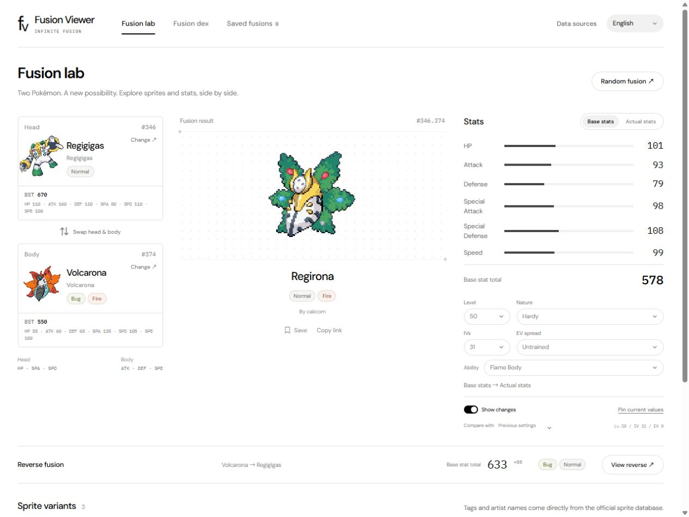
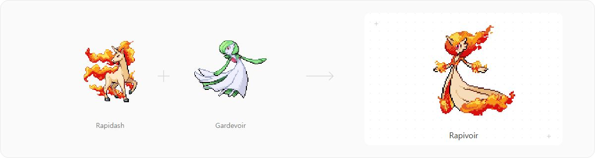

<div align="center">



<h1>Fusion Viewer</h1>

<p><strong>English</strong> &nbsp; · &nbsp; <a href="README.ko.md">한국어</a> &nbsp; · &nbsp; <a href="README.ja.md">日本語</a></p>

<p><strong>Mobile optimized · Compare stat changes · Easy search</strong></p>

<p>A compact viewer for Pokémon Infinite Fusion sprites and stats.<br>English by default, with Korean and Japanese support.</p>

<p>
  <a href="https://dominokorean.github.io/Pokemon-Fusion-Viewer/"><strong>Open Fusion Viewer ↗</strong></a>
  &nbsp; · &nbsp;
  <a href="#features">Features</a>
  &nbsp; · &nbsp;
  <a href="#search">Search guide</a>
  &nbsp; · &nbsp;
  <a href="#quick-start">Run locally</a>
</p>

</div>

## Features

| | What you can do |
| --- | --- |
| **Fusion lab** | Pick a head and body, randomize either parent independently, swap them, and compare the reverse fusion. Browser Back/Forward restores previously viewed pairs and variants. |
| **Sprites** | Browse official custom variants with artist credits, or view an autogenerated sprite when no custom sprite is available. |
| **Stats** | Compare base stats and calculated stats with level, nature, IVs, EVs, and inherited ability settings. |
| **Fusion dex** | Browse by type and sprite tag, sort results, and jump to any page by number. |
| **Search** | Search as you type, combine names, or use multiline advanced queries with syntax highlighting. |
| **Save & share** | Bookmark fusions in your browser and copy a link to the selected pair and sprite. |
| **Languages** | Switch between English, Korean, and Japanese. Your selection is remembered. |

The interface keeps controls and cards compact on small screens. The Pokémon picker keeps its search and filter controls fixed while results scroll; thumbnails use smooth downscaling. Sprite images load as needed, and dex searches run in a Web Worker to keep the interface responsive.

<p align="center">
  
</p>

### Stat controls

- **Level:** 1–100. **IVs:** 0–31, applied to all six stats.
- **Nature:** 25 choices, with stat modifiers shown.
- **EVs:** Presets or direct allocation, with a maximum of 252 per stat and 510 in total. Presets allocate up to 508.
- **Ability:** Choose an inherited basic ability, including the game's HP rule for Wonder Guard.
- **Comparison:** Deltas appear only for actual stats. Changing nature shows its current effect versus neutral nature with all other settings unchanged; numeric edits compare against the start of that edit. An explicitly pinned comparison is labeled separately. Changing either Pokémon clears previous and pinned comparisons. Multi-digit input is one edit.

Each stat control shows its calculation effect. The actual-stat total is distinguished from BST, and the expandable breakdown shows EV truncation, level scaling, nature percentages, and special HP rules.

Level and IV fields accept direct numeric input. Other dropdowns support text filtering; their arrow buttons open a selection-only menu. The language dropdown is selection-only.

Bookmarks and the last viewed fusion use `localStorage`. They stay in that browser and site origin; they are not synced between devices. With no valid saved view or denied storage, a fresh visit shows a random fusion. Explicit shared links take priority. Clearing site data removes saved data.

Calculation rules remain visible above sprite variants. GitHub and bug report / feedback links are available in the footer.

The picker keeps type, generation, sort and legendary filters when closed and reopened, including between head and body selection. Filters are remembered in this browser.

## Triple fusions

Browse **23 official triple combinations** on the Triple fusions tab. Each uses its dedicated base stats, types, abilities and sprite from the external game database. The viewer does not generate unsupported three-Pokémon combinations. Level, IV, EV and nature controls, bookmarks, shared links, browser history and last-view restoration work for triples too.

Refresh the triple snapshot with `npm run sync-triples` after updating the main snapshot. Source URLs and SHA-256 hashes are recorded in `public/data/triples.json`.

## Search

The searchable **Artist** selector sits beside sprite tags. Artist, tag and availability scope must match the same sprite; collaborations are credited to each artist. Advanced search also supports `artist:"daz1610" AND atk:>=80` (English field key).

### Simple search

Type a Pokémon name or fusion ID. Results update after a **220 ms** pause. Only the latest queued query is retained.

Separate terms with **spaces or commas** to require every term:

```text
Pikachu Bulbasaur
Pikachu, Bulbasaur
25.1
```

The first two queries find both head/body orders. Partial names and names from different supported languages can be combined.

Simple and advanced search keep their inputs and applied conditions separate. Simple search treats field expressions as plain text.

### Advanced search

Open **Advanced search** for multiline queries and syntax highlighting. Use **Apply query** or **Ctrl/Cmd + Enter** to run a query. The in-app **Query guide** includes examples.

```text
(type:fire OR type:poison)
AND atk:>=80
AND bst:>450
```

| Query | Meaning |
| --- | --- |
| `Pikachu` or `name:"Charizard"` | Match a parent Pokémon's name or the fusion name. |
| `type:poison` or `type:독` | Match the fusion's type; localized type names work too. |
| `atk:21` | Attack base stat equals 21. |
| `hp:>=100 AND spe:>80` | Combine numeric conditions. |
| `head:6 body:94` or `id:6.94` | Use **Infinite Fusion IDs** to select a head, body, or pair. |
| `tag:reference` | Match an official sprite tag. |
| `artist:"sample artist"` | Match an artist; quote values containing spaces. |
| `NOT type:water` or `type:!=water` | Exclude a type. |
| `custom:false` | Match autogenerated sprites. Also turn off the **Custom only** filter. |

Operators are case-insensitive. Precedence is `NOT` → `AND` → `OR`; parentheses override it. Spaces and newlines between conditions imply `AND`. Numeric fields are `hp`, `atk`, `def`, `spa`, `spd`, `spe`, and `bst`, all referring to **base stats**. Supported comparisons: `=`, `!=`, `>`, `<`, `>=`, `<=`.

Unknown fields, invalid numbers or types, and mismatched parentheses produce an error. Each pair appears once, with one matching sprite. Tag and artist conditions apply to that sprite; open the pair in the lab to see its variants.

## Quick start

Requires **Node.js 22+**. No npm packages need to be installed.

```sh
npm run dev
```

Open [localhost:5173](http://127.0.0.1:5173).

| Command | Purpose |
| --- | --- |
| `npm test` | Test calculations, queries, data parsing, and the local server. |
| `npm run verify-data` | Validate the imported data snapshot. |
| `npm run build` | Build the static site into `dist/`. |
| `npm run sync-data` | Refresh data from external sources; requires network access. |

The UI uses native ES modules, HTML, and CSS. `public/data/` contains snapshots imported from external databases. Sprites load from the official game repository, so an internet connection is needed for images. Failed data requests show an error and retry controls.

## Deploy to GitHub Pages

1. In your repository, open **Settings → Pages → Build and deployment** and set **Source** to **GitHub Actions**.
2. Push to `main`. The included [workflow](.github/workflows/pages.yml) runs tests, validates the data, builds the site, and deploys `dist/`. You can also run it manually from Actions.
3. Find the published URL in the workflow's `github-pages` environment.

Root domains and project subpaths such as `https://username.github.io/Pokemon-Fusion-Viewer/` are supported. No separate deployment token is required. Deployments use the committed data snapshot; refresh it with `npm run sync-data` and commit the results when you want to update it.

## Data & calculations

**Supported scope: 501 base Pokémon from the official public Infinite Fusion e18 database.** This is a specific data snapshot and may differ from the latest Hoenn release. The in-app **Data sources** panel shows the scope and retrieval date.

| Data | Source |
| --- | --- |
| Game IDs, base stats, types, and forms | [Official e18 species.dat](https://github.com/infinitefusion/infinitefusion-e18/blob/main/Data/species.dat) |
| Translated names, natures, types, abilities, and classifications | [PokeAPI CSV database](https://github.com/PokeAPI/pokeapi/tree/master/data/v2/csv) |
| Base and custom sprites | [Official sprite sheets](https://github.com/infinitefusion/infinitefusion-hoenn-public/tree/main/Graphics/CustomBattlers/spritesheets) |
| Autogenerated fusions | [Official autogenerated sheets](https://github.com/infinitefusion/infinitefusion-hoenn-public/tree/main/Graphics/Battlers/spritesheets_autogen) |
| Official in-game sprite inventory | [CUSTOM_SPRITES](https://github.com/infinitefusion/infinitefusion-hoenn-public/blob/main/Data/sprites/CUSTOM_SPRITES) |
| Tags and artist credits | [Official Sprite Credits.csv](https://github.com/infinitefusion/infinitefusion-hoenn-public/blob/main/Data/sprites/Sprite%20Credits.csv) |
| Fusion names | [Official SplitNames.rb](https://github.com/infinitefusion/scripts/blob/main/052_InfiniteFusion/Fusion/Data/SplitNames.rb) |
| Calculation rules | [Official FusedSpecies.rb](https://github.com/infinitefusion/scripts/blob/main/052_InfiniteFusion/Fusion/Data/FusedSpecies.rb) |

### Dex scope

The dex is split into **Game dex** and **In-game unverified**, based on the current official sprite inventory. Listed sprites include defaults and selectable alternatives, regardless of `main`, `alt`, or `temp` status. Images absent from that inventory appear only in the unverified group and its tag counts; this does not establish that they are unused. Availability can vary by installed game version; manual installation is separate. Automatic sprite selection still prefers listed `main`, falling back to listed `temp` when no main exists. Total fusion counts represent unique head × body combinations.

### Fusion stats

- **HP, Sp. Atk, Sp. Def:** ⅔ head + ⅓ body.
- **Attack, Defense, Speed:** ⅔ body + ⅓ head.
- Each contribution is **floored separately**, matching the game's code. Level, IVs, EVs, and nature are then used to calculate actual stats.

<details>
<summary><strong>Import details</strong></summary>

`catalog.json` metadata records retrieval dates, source URLs, and SHA-256 hashes. Ruby Marshal game data is parsed as data, never executed. National Pokédex IDs connect translations; Infinite Fusion IDs drive fusion pairs and sprite lookup.

Source forms can share translated names, so the picker also shows their original identifiers. Sprite credits are checked against the published image inventory, and variants with missing image files are excluded from the search index.

</details>

## Contribute to Pokémon Infinite Fusion

Pokémon Infinite Fusion is made possible by its many contributors! Get involved by adding sprites, writing Pokédex entries and contributing directly to Pokémon Infinite Fusion. [Official Discord community ↗](https://discord.gg/infinitefusion)

<sub>* Pokémon Infinite Fusion prohibits AI contributions.</sub>

For features not available here, please visit the following sites. [FusionDex](https://fusiondex.org/) · [Infinite Dex](https://infinitefusiondex.com/)

## Credits

Korean search uses **[hwantage/hansearch](https://github.com/hwantage/hansearch)** under the [MIT license](src/vendor/hansearch.LICENSE.txt). The vendored copy preserves the original algorithm; only its UMD wrapper was adapted to an ES module. Its source revision and copyright notice are included.

The fusion illustration features the official Rapidash and Gardevoir sprites, plus **Rapivoir (#78.287)** by **simply_mei** from the [official sprite sheet](https://raw.githubusercontent.com/infinitefusion/infinitefusion-hoenn-public/main/Graphics/CustomBattlers/spritesheets/spritesheets_custom/78/78.png).

Sprites belong to their respective artists. Pokémon © Nintendo / Creatures / GAME FREAK. Fusion Viewer is an unofficial fan tool.

---

<p align="center">
  <a href="https://dominokorean.github.io/Pokemon-Fusion-Viewer/"><strong>Open Fusion Viewer ↗</strong></a>
</p>
